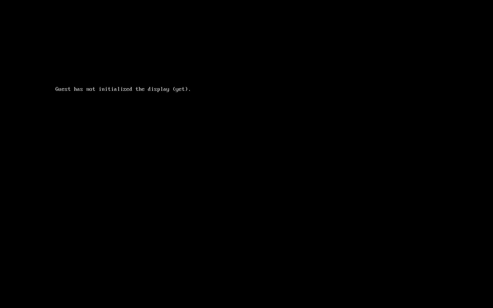

# Rustux

<p align="center">
  
</p>

An incremental reimplementation of the Linux kernel in Rust, verified against
the original C kernel's recorded behavior — and the first kernel to speak
IPv8 on the wire.

The C kernel source is the reference and stays untouched in a separate tree
(`$LINUX_REF`, default `~/linux-ref`). Each unit is ported one at a time with
[rust-anything](https://github.com/erkamyaman/rust-anything): the original's
behavior is recorded to `cases.jsonl`, the Rust port must match every recorded
case (`diff`) and pass `gate` before it is adopted.

<p align="center">
  
</p>

*Booting under OVMF/QEMU: memory map, APIC and PCI bring-up, the e1000
driver doing ARP/IPv4 ping/DHCP over slirp, then the 42-task userspace
test suite — including real BusyBox applets, dash, and dynamically
linked GNU bash 5.2 — on the GOP framebuffer console (recorded headless
via QMP screendump).*

<p align="center">
  
</p>

*A scripted session driving real GNU bash 5.2 (`make run-demo`):
every output byte is produced by actual bash under real fork/exec,
dynamic ld.so, pipes and job control (`jobs`, `kill %1`) — live
interactive input over the 16550 UART is `make run-bash` (headless
QEMU cannot feed serial input while a capture channel is attached,
so the session is scripted guest-side).*

## A world's first

Rustux carries the first known working implementation of
[draft-thain-ipv8](https://datatracker.ietf.org/doc/draft-thain-ipv8/):
the version-8 header, 32-bit Route Number + 32-bit local addressing,
and native EtherType `0x8080` — proven live between two Rustux
QEMU guests on a socket link:

```
B: ipv8: echo req from rn0x1 10.0.0.1 seq=1 -> replied
A: ipv8: echo reply rn0x2 10.0.0.2 seq=1 (71B native 0x8080)
```

Honest scope: IPv8 is an individual IETF Internet-Draft, not a
standard; its companion protocols (ARP8, ICMPv8, DHCP8, routing)
were never submitted, so Rustux implements only what the draft
actually specifies, plus clearly-labeled first-implementation
choices. IPv8 is an experimental differentiator — IPv6 remains on
the roadmap for real-world compatibility.

## Where the kernel is today

A `#![no_std]` UEFI kernel that boots under OVMF with its own GDT/IDT,
identity-mapped page tables, buddy allocator and slab heap, ACPI/LAPIC/
I/O-APIC interrupt routing, printk ring buffer, PCI enumeration, and an
e1000e NIC driver with real TX/RX DMA rings, MSI-X interrupt delivery,
ARP, IPv4, ICMP echo, and UDP/TCP over e1000 and loopback — plus the
IPv8 path above.

On top of that sits a growing Linux-ABI userspace: ring-3 tasks running
ELFs from a cpio initrd — static-PIE binaries and dynamically linked
ones via `PT_INTERP`/ld.so — a 100+-call syscall surface covering
`fork`/`execve`/`waitpid`, real signals with a sigreturn restorer
trampoline, `brk`/anonymous and file-backed `mmap`/`munmap`/`mprotect`,
a hierarchical VFS with a generated `/proc` (per-pid
`stat`/`status`/`comm`/`cmdline`/`statm`/`fd`/`fdinfo`, the
`exe`/`cwd`/`root`/`self` links, real utime/stime accounting,
`uptime`/`meminfo`/`loadavg`/`stat`/`cpuinfo`/`mounts`),
pipes, sockets (`socket`/`bind`/
`listen`/`accept`/`connect`, `poll`/`ppoll`/`pselect6`, `epoll`,
`eventfd`, `timerfd`, `getsockname`/
`getpeername`, `sendfile`), `rseq`, a keyboard- and UART-driven terminal
with a canonical/raw line discipline and full termios, real process
groups, sessions and a controlling tty (`/dev/tty`, `tcsetpgrp`,
SIGTTIN, SIGTTOU with TOSTOP — the whole job-control model), `clone`
flags up to full pthread-style thread groups (`CLONE_VM|FS|FILES|
SIGHAND|THREAD`, `SETTLS`, futex wait/wake, `CHILD_CLEARTID`), and real
`vfork` semantics — a shared-mm child running on the parent's stack
while the parent sleeps. The suite boots a real static **BusyBox**,
real Debian **dash**, and dynamically linked **GNU bash 5.2** — 42
tasks, all passing, zero frame leaks; `make run-bash` boots an
interactive `-bash` login shell on the serial console.

Every rung is also security-reviewed: a scoped audit of the diff plus a
check of that subsystem's published kernel CVEs — each gets a written
verdict in [docs/cve-matrix.md](docs/cve-matrix.md) (structurally
absent, explicitly mitigated, or a documented divergence), gathered
into a flat ledger of 100+ vulnerability classes so far.

## Acknowledgements

- **Linus Torvalds** — for the Linux kernel itself
  ([torvalds/linux](https://github.com/torvalds/linux)), the reference this
  project reimplements unit by unit.
- **[@erkamyaman_ng](https://x.com/erkamyaman_ng)** — for
  [rust-anything](https://github.com/erkamyaman/rust-anything), the
  record/diff/gate porting toolchain that drives every verified port here.

## Layout

- `kernel/` — the kernel itself; a `#![no_std]` UEFI application today
- `ports/` — per-unit work areas: extracted C harness + the verified Rust crate
- `docs/` — [kernel-map.md](docs/kernel-map.md) (subsystem inventory),
  [roadmap.md](docs/roadmap.md) (port order),
  [cve-matrix.md](docs/cve-matrix.md) (per-rung CVE rationale),
  [cves-addressed.md](docs/cves-addressed.md) (flat ledger of every CVE
  checked and protected against — regenerated by
  [tools/cve-ledger.py](tools/cve-ledger.py))
- [HANDOVER.md](HANDOVER.md) — per-rung continuation notes + ABI matrix
- `test/zorin/` — real-OS acceptance fixtures + ladder (see `test/zorin/README.md`)

## Build & test (Ubuntu 24.04 / Zorin OS 18.1)

Verified on Zorin OS 18.1 (Ubuntu 24.04 base) with gcc 13.3, QEMU 8.2.2 + OVMF,
cargo 1.100 via rustup:

```sh
rustup target add x86_64-unknown-uefi
sudo apt install qemu-system-x86 ovmf mtools gcc make

cargo test -p klib   # 327 unit tests for the ported klib modules
make run             # builds kernel.efi -> esp.img, boots under OVMF in QEMU;
                     # PASS when the kernel exits QEMU with status 33
make run-bash        # solo image: an interactive -bash login shell on
                     # the serial console — type into the terminal
make run-ttout       # solo image: the TOSTOP/SIGTTOU write-gate test
                     # (must own the machine; see HANDOVER run-91)
```

The kernel prints its boot proofs to COM1 and to a GOP framebuffer text
console (VGA 8x16 font from `lib/fonts/font_8x16.c`), runs its NIC
datapath and protocol self-tests live (ARP round-trip, IPv4 ping against
QEMU slirp, MSI-X receive interrupt), then exits via `isa-debug-exit` —
a `-display gtk` QEMU window shows the boot logo and the kernel's own
console output.

Rustux is GPL-2.0-only (`LICENSE`): its ported units are derivative
works of GPL-2.0-only kernel code.
